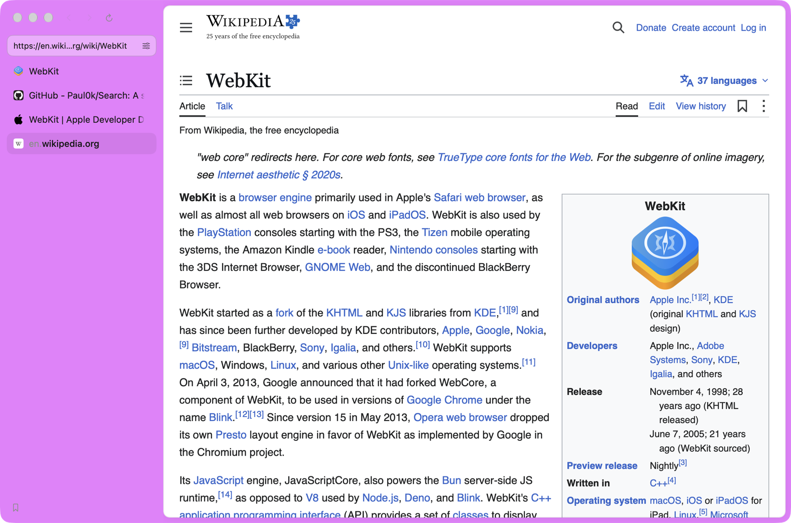
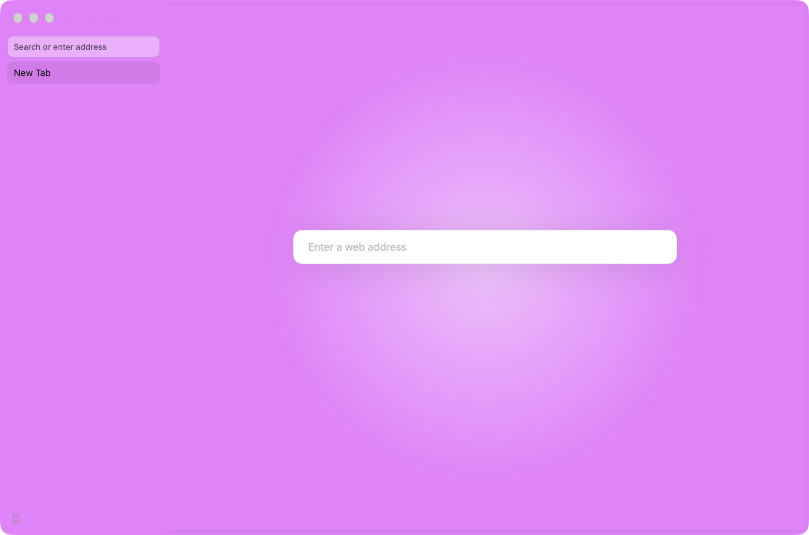
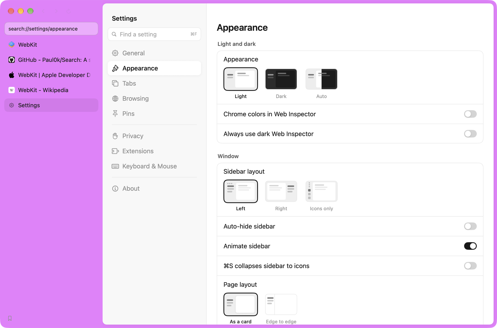

# Search

A small, quiet web browser for the Mac: your tabs down the side, the page beside them, and nothing else in the way.

This is a personal fork of [driceroland/Search](https://github.com/driceroland/Search) by [Office Commun](https://officecommun.com). It has been slimmed down — no updater, no sync, no spaces or profiles, no password manager of its own — and you build it yourself with `./build.sh`.



macOS 14 or later · built from source (see [Building it](#building-it))

---

## What it is

A browser with a sidebar for your tabs and the page. No toolbar, no start page of suggestions, no account to sign into. You type an address or a few words into one field and you are on the page.

It uses **WebKit**, the engine already inside every Mac (the one Safari runs on). That is why the whole app is about 10 MB and opens instantly: there is no second copy of Chromium to download, update and keep in memory.

## What it does

- **One field**, at the top of the column. Type an address and you go there; type words and you search. Addresses are finished from your own history and bookmarks, and your search engine suggests searches as you type (Settings › Browsing turns that off, and then nothing you type leaves the Mac until you press Return). Type the start of a site's name and press Tab to search that site directly. `⌘T` raises the field over the page you are on, and typing `settings` or `new tab` there goes straight to that part of the app.
- **From any app.** `⌥⇧^` (the key left of 1) brings up the same field over whatever app you are in.
- **Tabs in a column.** On the left or the right, or narrowed to icons. `⌘S` folds it away, or let it hide itself until the pointer reaches the edge. Tabs from your last session come back instantly and cost nothing until you click them. `⌘K` finds an open tab by name, `⌃Tab` shows your recent ones.
- **Pins.** Keep the sites you use all day as pinned squares or rows, in folders if you like. A pin keeps its site: links elsewhere open over it, and `⌘W` takes it back home.
- **Tab groups.** Right-click a tab › Add to New Group.
- **Split View.** Two pages side by side: drag a tab onto a page, `⌥`-click a tab, or press `⌥⌘N`. Pairs and their widths come back after a restart.
- **Keep a site awake.** Choose Keep This Site Awake on the site's card and that tab is never put to sleep, even under memory pressure.
- **Reading mode.** `⇧⌘R` strips a page down to the article.
- **Hide anything, for good.** `⇧⌘H`, then click a cookie banner, a newsletter overlay, a rail of "related" links — it goes, and stays gone on that site before the page has drawn a single frame.
- **Ads blocked** before they load.
- **Video that follows you.** `⇧⌘P` lifts a video into a small window that stays above everything.
- **Translate pages** on your Mac: right-click a page › Translate Page. Nothing is sent anywhere.
- **Light, dark or automatic**, and a **theme**: a new install starts with the whole window in pink. Settings › Appearance › Theme changes it to another colour, a gradient or an image, or turns it off.
- **Bookmarks, history, downloads** — each a panel, each searchable, each one keystroke away.
- **Chrome extensions, without Chrome.** Paste a Chrome Web Store link in Settings › Extensions, or open the extension's page and press Add. They run on WebKit's own extension engine, and where Chrome has APIs WebKit doesn't, Search fills them in. Use your password manager's extension (Proton Pass, 1Password, Bitwarden) for passwords and passkeys. Unpacked extensions load from a folder, as in Chrome's developer mode. macOS 15.4 or later.



A search field at the top of Settings finds any option, and resting the pointer on a row explains what it does.



## What it doesn't do

On purpose:

- **No passwords of its own.** Search doesn't save, fill or offer passwords or passkeys. Sites are told there are no passkeys here, so they go straight to the password your extension fills.
- **No sync, no account, no cloud.** Your tabs, history and bookmarks are on your Mac and nowhere else.
- **No telemetry**, no analytics, no crash reports sent anywhere.
- **No updater.** You get a new version by pulling and building again.

## Privacy, concretely

| What | Where it is | Who can read it |
|---|---|---|
| History, bookmarks, open tabs, hidden elements | Small JSON files in `~/Library/Application Support/Search/` | You. |
| Cookies and site data | WebKit's own store for the app | The sites that set them, as in any browser. |
| Extensions | `~/Library/Application Support/Search/Extensions/`, their data in WebKit's extension store | Each extension, within the permissions you accepted. |
| Anything else | Nowhere. There is no server. | — |

A **private tab** (`⇧⌘N`) has its own cookie jar and leaves nothing behind when it closes.

Apps you allow in System Settings › Privacy & Security › Automation can read the address and title of your tabs with AppleScript; private tabs are never shown.

## Keyboard

| | |
|---|---|
| `⌘L` address · `⌘K` switch tab · `⌘T` new tab · `⌥⌘T` blank tab | `⌘W` close · `⇧⌘T` reopen closed tab · `⌘1`–`⌘9` jump |
| `⌘[` `⌘]` back, forward · `⌃Tab` `⌃⇧Tab` next, previous tab | `⌘S` fold the sidebar · `⇧⌘B` bookmark this page |
| `⇧⌘R` reading mode · `⇧⌘P` float the video | `⇧⌘H` hide something · `⇧⌘U` what is hidden here |
| `⌘F` find · `⌘D` duplicate tab · `⇧⌘C` copy address | `⌘Y` history · `⇧⌘J` downloads · `⌘,` settings |
| `⌥⌘N` split the current page · `⌃⌘←` `⌃⌘→` other pane | `⌘R` reload · `⌥⌘R` reload from origin |

`Tab` stays the page's, for moving through a form. `esc` puts away whatever is open. Every shortcut can be changed in Settings › Keyboard & Mouse.

---

## For developers

### Building it

- macOS 14 or later, Xcode 16 / Swift 6 toolchain. No dependencies beyond what Apple ships.
- `swift build` runs the app straight from the SwiftPM binary.
- `./build.sh` assembles a double-clickable `Search.app` in `build/`, ad-hoc signed so it runs on your own Mac. Copy it to `/Applications` to use it day to day.
- `SEARCH_DEV=1 ./build.sh` makes a dev build with a yellow icon, named after its branch, so it is never mistaken for your everyday copy. It shares that copy's settings and bundle id.
- `./fresh.sh` opens the built app as a first launch in a test world of its own (its own folder, settings and cookies), without touching the browser you use.

Because the build isn't notarized, the first launch may need a right-click › Open, or an allow in System Settings › Privacy & Security.

### How it's put together

About 90,000 lines of Swift in `Sources/Search/`, one file per concern — `Curtain.swift` the hidden elements, `Session.swift` what comes back at launch, `Settings.swift` and `SettingsIndex.swift` the Settings page, and so on.

- **SwiftUI** for everything drawn, **AppKit** where SwiftUI doesn't reach (the title bar, window dragging), **WKWebView** for pages.
- One `Tab` per page. Its web view is built lazily, so a tab restored from last session costs no process until you switch to it.
- Hidden elements are a per-site list of selectors injected as a stylesheet at document start, so nothing is ever seen appearing and vanishing.
- Every colour is a light/dark pair in `Design.swift`; nothing else in the code knows which mode it is in.
- Extensions run on `WKWebExtension`. `Crx.swift` fetches from the Chrome Web Store and checks the CRX3 signature before unpacking; `Extensions.swift` is the browser's side of WebKit's contract; `ExtensionShims.swift` supplies the Chrome APIs WebKit lacks and smooths over where it behaves differently; `ExtensionNative.swift` speaks Chrome's native messaging.

### Testing it without closing it

Turn on **Settings › About › Developer › Enable test socket** and the running app listens on a Unix socket in its own folder, readable only by your user. `./bench` speaks it:

```
./bench open https://example.com     # a tab of its own, marked with a flask
./bench wait 2e7e7e89                 # until it has loaded
./bench text 2e7e7e89                 # the page's text
./bench shot 2e7e7e89 out.png         # a picture of it
./bench click 2e7e7e89 "button.go"    # click, type, submit through the page's own events
./bench close all
```

Bench tabs are never selected for you, never enter the session or history, and go when the script says so.

A coding agent can drive a hidden test copy through `./bench-mcp`, an MCP server over the same socket: `claude mcp add search-bench -- "$PWD/bench-mcp"`. Each session starts `build/Search.app` in a test world of its own and wipes it when it closes. `python3 Tests/bench_mcp.py` checks it end to end.

To let an agent use the Search you have open, turn on **Settings › About › Developer › Allow coding agents** and add `./search-mcp`: `claude mcp add search -- "$PWD/search-mcp"`. Search asks in the window each time one connects, shows Stop while it is there, and keeps it to tabs of its own. The rules are in `Sources/Search/AgentControl.swift`; `python3 Tests/agent_control.py` checks them.

`swift test` runs the unit tests; the Python scripts in `Tests/` each check one feature in a hidden test run after `./build.sh`.

### Contributing

See [CONTRIBUTING.md](CONTRIBUTING.md). The short version: small changes, no new dependencies, nothing that phones home. Security problems go privately, as [SECURITY.md](SECURITY.md) says.

### License

MIT — see [LICENSE](LICENSE). "Search" and the app icon come from Office Commun's original; please rename a fork before distributing it.
